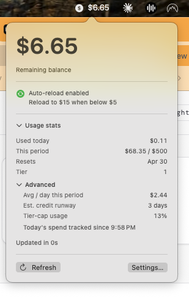
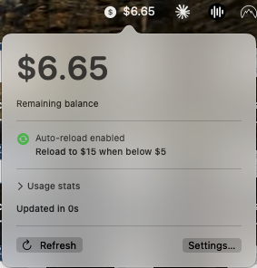
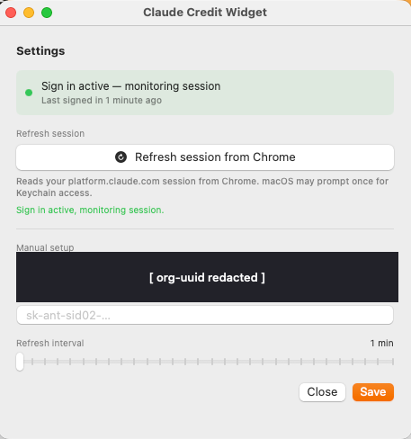

# Claude Credit Widget

A native macOS menu-bar app that shows your **Anthropic Claude API credit balance**, current spend, and usage stats — live, in your menu bar, without keeping a browser tab open on the billing page.

<p align="center">
  
</p>

## Why

Anthropic's public API has no documented endpoint for your prepaid credit balance ([open feature request](https://github.com/anthropics/claude-code/issues/47574)). If you want to know "how much money do I have left?" you have to keep https://platform.claude.com/settings/billing open or refresh it manually.

This widget reads that same number — plus current period spend, monthly tier cap, rate-limit tier, and burn-rate estimates — directly from your existing `platform.claude.com` browser session.

## Features

- **Live balance** in the menu bar — `$X.XX` updates on a configurable interval (default 5 min)
- **One-click sign-in via Chrome** — imports your existing platform.claude.com session by reading Chrome's local cookie store (no API key, no manual cookie pasting)
- **Usage stats** — *Used today* (delta-tracked), *This period* (with monthly cap), *Resets*, *Tier*
- **Advanced stats** — average daily spend, estimated credit runway in days, % of monthly tier cap used
- **Auto-reload status** — shows whether you have auto-reload enabled and the threshold/refill amount
- **Right-click menu** — Refresh, Sign in, Open Billing Page, Settings, Open Log, Restart, Quit
- **Native macOS** — pure Swift / SwiftUI / AppKit, no Electron, no telemetry, no background services

## Screenshots

| Menu bar + balance | Settings (signed in) |
| --- | --- |
|  |  |

## Requirements

- macOS 14 (Sonoma) or later
- Google Chrome with an active logged-in session at `https://platform.claude.com`
- Xcode Command Line Tools (`xcode-select --install`) — full Xcode is **not** required
- Swift 5.9+ (ships with recent Command Line Tools)

## Installation

```bash
git clone https://github.com/arpan-ghosh/claude-credit-balance-floating-widget.git
cd claude-credit-balance-floating-widget
./build.sh
open build/ClaudeCreditWidget.app
```

The build script:
1. Generates the app icon (`Resources/AppIcon.icns`) from `Tools/generate_icon.swift` (only on first run, or if missing)
2. Compiles a release binary via `swift build -c release`
3. Assembles a proper `.app` bundle in `build/ClaudeCreditWidget.app`

To install permanently, drag the `.app` to `/Applications/`:

```bash
cp -R build/ClaudeCreditWidget.app /Applications/
```

To launch on login: System Settings → General → Login Items → add `ClaudeCreditWidget`.

## First-time setup

1. **Launch the app.** A `$` icon appears in your menu bar.
2. **Click the `$` icon** to open the popover.
3. **Click "Sign in with Chrome"** (or right-click the icon → "Sign in with Chrome").
4. **Allow** the macOS Keychain prompt — this lets the app read Chrome's "Chrome Safe Storage" entry, which is the encryption key for your cookie store.
5. The balance appears in the menu bar within ~1 second.

That's it. The widget will auto-refresh every 5 minutes (configurable in Settings).

## How it works

### Data sources

The widget calls three undocumented endpoints on `platform.claude.com`, authenticated with your Chrome session cookie:

| Endpoint | Purpose |
| --- | --- |
| `GET /api/organizations/{org_id}/prepaid/credits` | Balance + auto-reload settings |
| `GET /api/organizations/{org_id}/current_spend` | Spend this billing period + reset date |
| `GET /api/organizations/{org_id}/rate_limits` | Tier + monthly tier cap |

These are the same endpoints the Console UI itself uses. They are **not part of the public API** and may change without notice. If they break, the relevant decoders live in `Sources/ClaudeCreditWidget/Models.swift` and the requests in `CreditService.swift`.

### Sign-in via Chrome

The widget never asks you to paste a session cookie. Instead it:

1. Opens Chrome's encrypted cookie SQLite database at
   `~/Library/Application Support/Google/Chrome/Default/Cookies` (read-only, copied to a temp file).
2. Reads the encryption key from your macOS Keychain (`service: "Chrome Safe Storage"`, `account: "Chrome"`) — this triggers the one-time Keychain access prompt.
3. Derives an AES key via PBKDF2-SHA1 (`salt = "saltysalt"`, `iters = 1003`, `keylen = 16`) — the standard Chrome-on-macOS scheme.
4. Decrypts each `v10`-prefixed cookie blob with AES-128-CBC (`iv = 16 spaces`, PKCS7 padding).
5. **Strips the leading 32 bytes** of the resulting plaintext: Chrome 130+ on macOS prepends `SHA256(host_key)` as an integrity check.
6. Pulls out two cookies:
   - `sessionKey` — the auth token (stored in our Keychain entry, not on disk)
   - `lastActiveOrg` — your organization UUID (stored in `UserDefaults`)

If the session expires, you'll see "Session expired" in the popover; click *Refresh session from Chrome* in Settings or right-click → *Sign in with Chrome* and you're back in.

### Daily spend tracking

There's no per-day endpoint, so "Used today" is computed locally: the widget snapshots the period spend at the first refresh of each new day and shows today's spend as the delta from that baseline. The Advanced section's footnote tells you exactly when today's tracking started, so you can see what window the number covers.

## Right-click menu

| Item | Action |
| --- | --- |
| Refresh | Force an immediate API refresh |
| Sign in with Chrome | Re-import the session from Chrome (also doubles as "log in") |
| Open Billing Page | Open `platform.claude.com/settings/billing` in your browser |
| Settings… | Configure org ID, sessionKey (manual), refresh interval |
| Open Log… | Opens `~/Library/Logs/ClaudeCreditWidget/widget.log` |
| Restart | Quit and relaunch the app |
| Quit | Quit |

## Settings

<p align="center">
  
</p>

- **Sign in active banner** (green) — shown when you have a valid session, with a relative timestamp
- **Refresh session from Chrome** — re-imports cookies, useful after a Chrome re-login
- **Manual setup** — paste an org ID and `sessionKey` directly if you want to bypass Chrome import
- **Refresh interval** — 1 to 30 minutes
- **Save** flashes a green "Saved" indicator; **Close** dismisses the window

## Privacy & security

- Your `sessionKey` is stored in **your macOS Keychain**, under service `com.arpan.ClaudeCreditWidget`. It never lives in plaintext on disk.
- The widget makes network calls only to `platform.claude.com`. No telemetry, no analytics, nothing else.
- All cookie decryption happens locally; nothing leaves your machine.
- The widget is **read-only** — it only fetches data, never modifies your account.
- Logs at `~/Library/Logs/ClaudeCreditWidget/widget.log` log only metadata (lengths, hashes, status codes), never the raw session cookie or password.

## Limitations

- **Default Chrome profile only.** If you use a different profile, the cookie import will fail. (Multi-profile picker is on the roadmap.)
- **Chrome must be installed.** Other browsers aren't supported — auto-import would need a per-browser cookie scheme.
- **Undocumented endpoints.** If Anthropic changes the Console API, the widget will need updating.
- **macOS only.** No Windows / Linux support planned.
- **Token counts not shown.** Only spend in dollars — there's no public token-count endpoint reachable via the cookie session.

## Project layout

```
.
├── Package.swift                       — Swift Package manifest
├── build.sh                            — One-shot build → .app bundle
├── Resources/
│   ├── AppIcon.icns                    — App icon (regenerable)
│   └── Info.plist                      — LSUIElement = true (no Dock icon)
├── Sources/ClaudeCreditWidget/
│   ├── App.swift                       — @main entry, NSApplicationDelegateAdaptor
│   ├── AppDelegate.swift               — NSStatusItem + popover + right-click menu + Settings window
│   ├── ContentView.swift               — Popover SwiftUI view
│   ├── SettingsView.swift              — Settings SwiftUI view
│   ├── CreditStore.swift               — ObservableObject state, polling, daily delta tracking
│   ├── CreditService.swift             — URLSession calls to platform.claude.com endpoints
│   ├── Models.swift                    — Decodable response types
│   ├── ChromeCookieImporter.swift      — Reads & decrypts Chrome's cookie store
│   ├── Crypto.swift                    — PBKDF2 + AES-CBC + SHA256 via CommonCrypto
│   ├── KeychainStore.swift             — Save/load sessionKey in our Keychain entry
│   └── Logger.swift                    — File log + os_log
└── Tools/
    ├── generate_icon.swift             — Renders 1024×1024 source PNG
    └── build_icns.sh                   — Wraps PNG → .iconset → .icns
```

## Customising the icon

Edit `Tools/generate_icon.swift`, then:

```bash
bash Tools/build_icns.sh
./build.sh
```

## Troubleshooting

**"Failed to decrypt cookie sessionKey"**
You likely denied or never received the macOS Keychain prompt. Re-trigger by right-clicking the menu bar icon → *Sign in with Chrome*. If the prompt doesn't appear, open Keychain Access, find "Chrome Safe Storage", and add the widget to its Access Control.

**"Session expired"**
Your Chrome session cookie rotated. Right-click → *Sign in with Chrome* re-imports it.

**Menu bar shows the icon but no balance**
Open the log: right-click → *Open Log…*. The log records every step of every refresh; an HTTP error or auth failure will show up as a clear line.

**Settings window opens too small**
Should be fixed in the latest build. If not, file an issue with your macOS version.

## License

MIT — see [LICENSE](LICENSE).

## Disclaimer

This is an unofficial tool. It is not built by, endorsed by, or affiliated with Anthropic. The endpoints it calls are undocumented and may change at any time. Use at your own risk.
